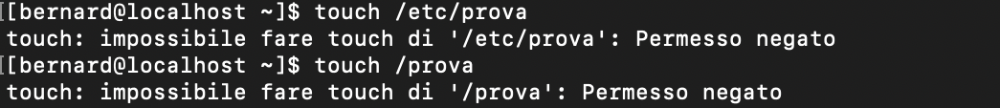

# ESERCIZIO 1

1. **Touch:** Illustrare almeno 2 casi in cui il comando touch può generare una condizione di errore.

# SOLUZIONE 1

L'idea è quella di verificare appunto in quale situazione touch dia una condizione di errore, inizialmente ho pensato per dei semplici casi , come ad esempio errore di battitura nel comando stesso o nelle sue opzioni.

Successivamente ho optato per degli errori riguardanti la mancanza di permessi di poter creare appunto tale file in delle cartelle specifiche nelle quali solo e soltanto l'utente root può fare delle modifiche .

