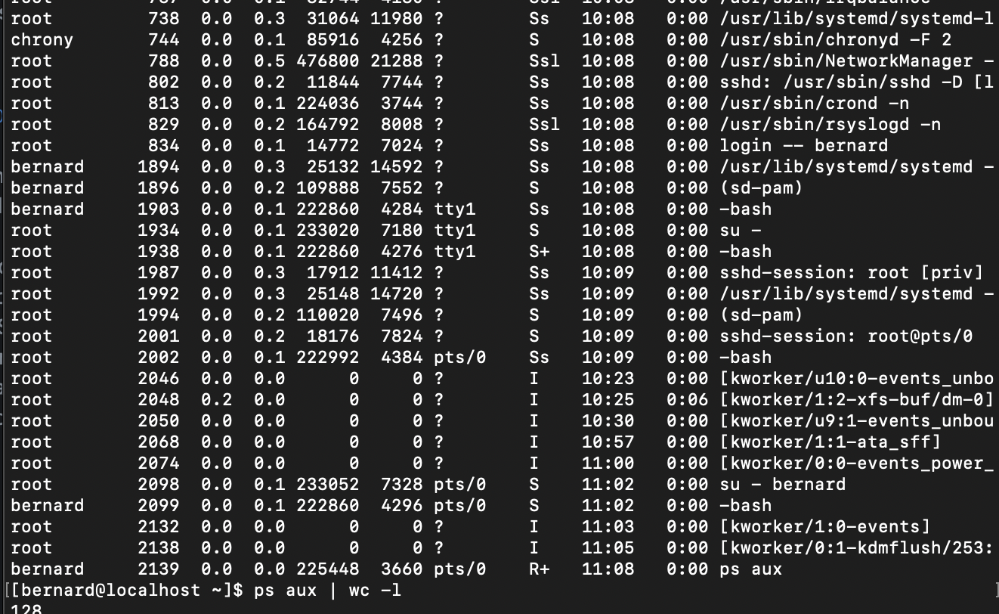

# ESERCIZIO 2

2. **Numero Processi:** Contare il numero totale di processi attualmente in esecuzione sulla propria macchina senza utilizzare utility interattive come "top".

# SOLUZIONE 2

Ho pensato ad utilizzare comandi che permettessero di elencare il numero totale di processi in esecuzione sulla macchina e l'unico che mi è venuto in mente per poter elencare è `ps aux` , successivamente con un | e con un `wc -l` conto appunto il numero totale dei processi che appaiono in output .

