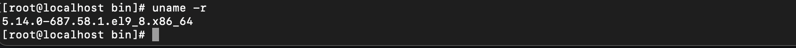
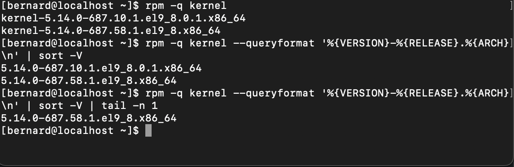
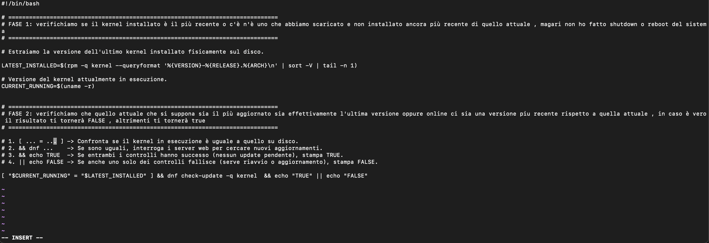
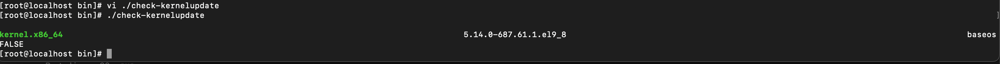

# ESERCIZIO 3

- **Kernel Version:** Trovare il modo (o più modi) per capire se il Kernel attualmente running è il più recente installato sulla macchina. Scrivere uno script che esegua automaticamente il controllo e risponda TRUE/FALSE.

# SOLUZIONE 3

Allora , la prima cosa che ho fatto è stata verificare il kernel del mio sistema operativo, quindi con i comandi uname -a e poi vedendo che l'output era troppo lungo mi sono concentrato sulla versione chiedendola appunto con uname -r .



Poi mi sono detto che avevo bisogno di un confronto perchè a volte scarichi una versione recente e non viene installata quindi nel kernel mi sono assicurato di avere la più recente .

Per fare questa verifica ho quindi confrontato uname -r che è la versione attualmente montata con rpm -q —queryformat '%{VERSION}-%{RELEASE}.%{ARCH}\n' che mi permette di listare tutte le versioni presenti attualmente e con | sort -V | tail -n 1 mettermi per ultima la piu recente e mettermela in output .



Dopodichè appunto faccio il confronto tra le due e verifico se perlomeno nel sistema la più recente tra quelle che ho disponibili localmente è stata installata .

Confrontiamole : `[ "$(uname -r)" = "$(rpm -q kernel --queryformat '%{VERSION}-%{RELEASE}.%{ARCH}\n' | sort -V | tail -n 1)" ]`

per darci un risultato stampato affianchiamo
&& echo "TRUE" || echo "FALSE"

se entrambi i controlli hanno successo ——-> 0 vuol dire che il kernel installato è il piu recente quindi TRUE , altrimenti se uno dei due è diverso dall'altro ————-> 1 in output darà false

Questo perchè abbiamo detto con sort -V di mettermi il piu recente per ultimo e con tail -n 1 di stamparmi appunto solo ed esclusivamente l'ultimo output tra i kernel presenti nel sistema operativo .

```bash
[ "$(uname -r)" = "$(rpm -q kernel --queryformat '%{VERSION}-%{RELEASE}.%{ARCH}\n' | sort -V | tail -n 1)" ] && echo "TRUE" || echo "FALSE "
```

. Ora , dopo aver verificato questo procedo a terminare la diagnostica e verifico appunto se il mio `dnf check-update -q kernel` mi dà effettivamente lo stesso kernel della stessa versione presente all'interno del sistema . L'output del confronto locale già ce l'ho mi manca da confrontare quello a quello online e verificare se è la stessa versione o meno .

dunque l'idea è di fare lo stesso ragionamento logico :

```bash
[ "$(uname -r)" = "$(rpm -q kernel --queryformat '%{VERSION}-%{RELEASE}.%{ARCH}\n' | sort -V | tail -n 1)" ] && dnf check-update -q kernel && echo "TRUE" || echo "FALSE "
```

Questo come nel caso precedente se dà 0 stampa true e quindi vuol dire siamo alla stessa versione se da 1 in output stampa false che signfica appunto c'è una versione piu recente da installare .

Manca dunque da farci uno script con questa cosa , cosi che inviando il comando permetto appunto di verificare in modo piu veloce senza stare a scrivere righe e righe di comando perdendo tempo oppure sbagliando per via di errori di battitura .

creo dove tendenzialmente si deve creare dunque nel path /usr/local/bin/ il mio script e con vi appunto lo inizio a creare e personalizzare .

Il risultato è questo :



Il file dello script è disponibile qui: [check-kernelupdate](./check-kernelupdate)

Questa è l'esecuzione con il comando di esecuzione dello script e del relativo output :


