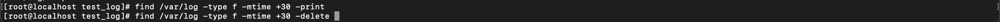
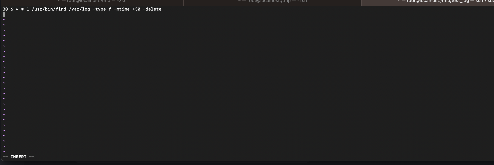

# ESERCIZIO 4

- **Find e Cron**: Utilizzare il comando find per trovare e cancellare i file più vecchi di 30 giorni (ad esempio in /var/log o simili). Schedulare tale comando in crontab di root ogni lunedi mattina alle 6:30. Sulle manpages trovate tutte le info di cui avete bisogno.

# SOLUZIONE 4

non c'erano file piu vecchi di 30 giorni , volendo avrei potuto crearne uno e modificarne la data con touch -d per verificare .

Crontab schedula appunto il comando per ogni lunedi mattina alle 6:30 .

per l'utilizzo di crontab mi sono munito dell'ausilio dell'ai in quanto non trovando appunti o anche istruzioni dal man adeguate ho ricorso appunto ad una ricerca rapida online .

